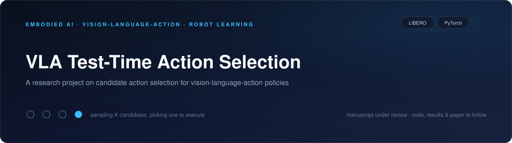

<div align="center">


# VLA Test-Time Action Selection

**A research project on candidate action selection for vision-language-action policies**

[](LICENSE)
[](https://www.python.org/)
[](https://pytorch.org/)
[](https://libero-project.github.io/)
[](https://github.com/rzc156/near-zero-headroom/actions/workflows/ci.yml)
[](https://github.com/rzc156/near-zero-headroom/stargazers)

[中文说明](README_zh.md)

</div>

---

## About

This repository hosts a research project on **test-time action selection for
vision-language-action (VLA) policies**. A flow-matching / diffusion decoder can
sample several candidate action chunks for the same observation; this project
studies how a policy should pick the one to execute, evaluated with open VLA
policies on the [LIBERO](https://libero-project.github.io/) benchmark on a
single consumer GPU.

> ### 📄 Manuscript under review
>
> The paper for this project is **currently under review**.
> The **manuscript, code, figures and full results will be released in this
> repository after publication**. There is no preprint at this time.

## Repository layout

```text
near-zero-headroom/
├── assets/       # project banner
├── configs/      # experiment configuration          (to be released)
├── docs/         # documentation                     (to be released)
├── experiments/  # experiment drivers                (to be released)
├── paper/        # manuscript                        (under review)
├── results/      # result artifacts                  (to be released)
├── scripts/      # environment & utility scripts     (to be released)
├── src/          # method code                       (to be released)
├── README.md     # this file
└── README_zh.md  # 中文说明
```

## Status

| Item | Status |
|---|---|
| Repository scaffold & tooling | ✅ |
| Method code (`src/`) | 🚧 after publication |
| Experiments (`experiments/`, `configs/`) | 🚧 after publication |
| Results (`results/`) | 🚧 after publication |
| Manuscript | 🚧 under review |

## Environment (reference)

Python 3.12 · PyTorch · [LeRobot](https://github.com/huggingface/lerobot) ·
[LIBERO](https://github.com/Lifelong-Robot-Learning/LIBERO) · a single NVIDIA GPU
(16 GB). See [`requirements.txt`](requirements.txt) for the reference package set.

## Citation

Citation information will be provided once the manuscript is published
(see [`CITATION.cff`](CITATION.cff) for the placeholder).

## License

Released under the [MIT License](LICENSE).
